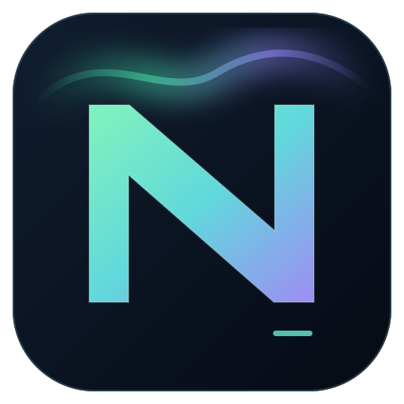
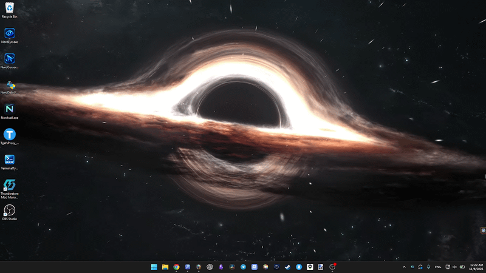

# Nordwall



**Nordwall** is an experimental lightweight animated wallpaper engine for Windows 11. It plays offline HTML/ASCII animations and local MP4/WebM videos behind desktop icons. A system tray menu lists the available wallpapers each time you open it.

This repository is a source project, ready for development and publication on GitHub. It includes five optional ASCII wallpaper examples in the source tree and a standalone Windows build script.

> **Status:** early release candidate. The desktop embedding code has been tested on Windows 11, but the new embedded-content standalone release still needs verification on Windows. Multi-monitor support and automatic game detection are not included yet.



Animation is taken from: https://www.youtube.com/watch?v=gU4vSEZwiyE

## Run from source

Install the [.NET 10 SDK](https://dotnet.microsoft.com/download/dotnet/10.0), download the source, and double-click `run.cmd`.

Alternatively, run from the repository root:

```powershell
dotnet run --project Nordwall/Nordwall.csproj --configuration Release
```

`run.cmd` starts the program through `dotnet run`, so the console may remain open until Nordwall exits.

## Build a standalone EXE

On a Windows x64 computer with the .NET 10 SDK installed, double-click **`publish.cmd`**. When the build finishes, it creates:

```text
release/
  Nordwall-standalone-win-x64/
    Nordwall.exe
  Nordwall-standalone-win-x64.zip
```

The publish command uses a **self-contained, single-file .NET deployment**. People who download `Nordwall.exe` do not need the .NET SDK or a separate .NET runtime. The WebView2 SDK libraries and native loader are included in the .NET single-file publish. **Microsoft Edge WebView2 Runtime** is still required separately; it is normally preinstalled on Windows 11.

The internal `assets` are embedded inside `Nordwall.exe`, so there is no `assets/` directory required next to the executable. On startup, Nordwall creates an **empty** `Documents\Wallpapers` folder (using your actual Windows Documents location). It never adds, restores, or overwrites wallpapers automatically. The internal video player is cached under `%LOCALAPPDATA%\Nordwall\assets`, which is created automatically. No setup wizard or SDK is needed on the user's PC.

You can distribute **just `Nordwall.exe`**. Move it to its final location before enabling autostart. The system tray icon reads the icon already embedded in the executable.

GitHub Actions is configured to build and upload the `Nordwall-standalone-win-x64` artifact on pushes and pull requests. No public release is made automatically.

## Controls

Right-click the Nordwall icon in the system tray to select a wallpaper, pause/resume playback, open the wallpaper folder, toggle **Launch at sign-in**, or exit.

Startup is **disabled by default**. When enabled, Nordwall creates a registry value for the current Windows user under:

`HKEY_CURRENT_USER\Software\Microsoft\Windows\CurrentVersion\Run`

The entry points to the full path of the running executable. Disable autostart before moving the program to a different folder, then enable it again from the new location. Administrator rights are not required.

## Wallpapers

Five optional HTML examples are kept in the source repository and can be published as a separate wallpaper pack. They are **not** included in the published executable:

```text
01-ascii-orbit.html
02-ascii-waves.html
03-ascii-tunnel.html
04-ascii-aurora.html
05-ascii-galaxy.html
```

Only each wallpaper's title is displayed beneath its ASCII artwork. Animation frames are precomputed, and their mathematical motion loops continuously without an abrupt reset.

Put `.html`, `.htm`, `.mp4`, or `.webm` files directly into `Documents\Wallpapers`. The tray menu refreshes whenever it opens, so a restart is unnecessary to discover new files. Nested directories are not scanned yet. You can double-click the tray icon to open the exact folder. Nordwall never creates or restores wallpaper files; for example, deleting an HTML wallpaper leaves it deleted until you add it again.

When upgrading from an earlier Nordwall release that stored media next to the EXE, copy any wallpapers you want to keep from the old `wallpapers` folder into `Documents\Wallpapers`. Nordwall does not move or delete those old files automatically.

HTML files can reference local images, stylesheets, scripts, and fonts using relative paths. The host blocks requests to external websites. Video is muted, looped automatically, and fills the monitor using `object-fit: cover`.

Actual CPU/GPU usage and video hardware decoding depend on the media file, codec, graphics driver, and WebView2 Runtime. Nordwall may appear as several processes in Task Manager.

## Windows compatibility

Nordwall currently supports the primary monitor only. The embedding code uses the undocumented `Progman` / `WorkerW` desktop layout and the `0x052C` message. On newer Windows 11 versions, `WorkerW` can be a child of `Progman` instead of a separate top-level window. Nordwall checks both layouts and uses a guarded fallback that orders the wallpaper behind desktop icons. Windows updates can change these internals.

The WebView2 NuGet package may import an unused WPF reference into WinForms projects. `Nordwall.csproj` removes that reference before dependency resolution to address the `WindowsBase` MSB3277 warning, without suppressing other warnings.

## Next steps

Automatic pause for fullscreen games, multiple displays, more performance controls, startup diagnostics, and a signed installer.
